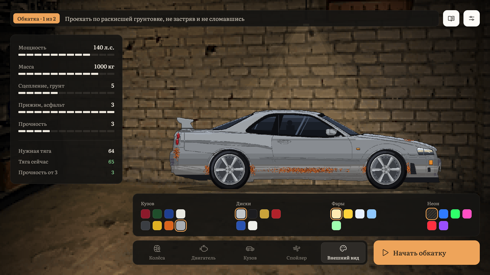
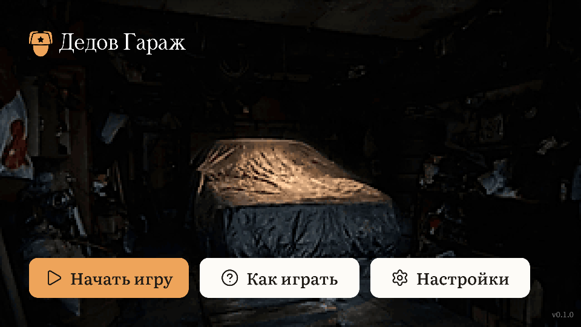
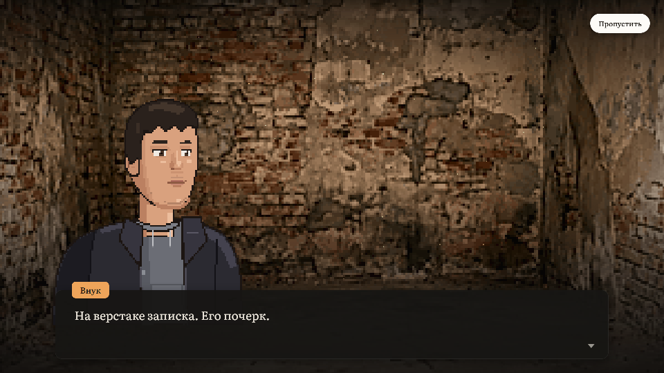
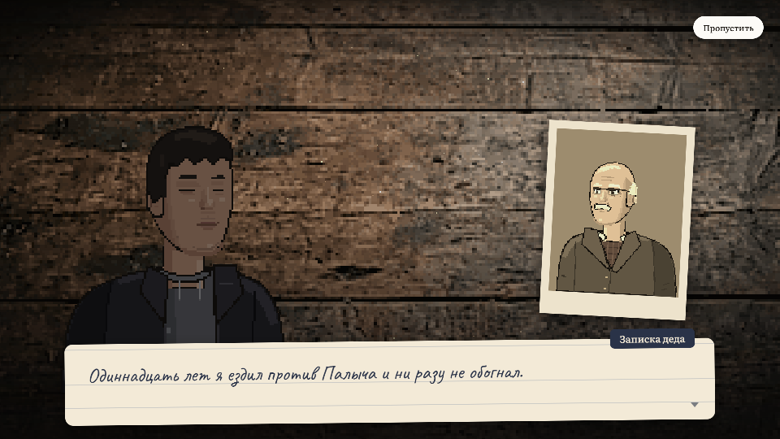
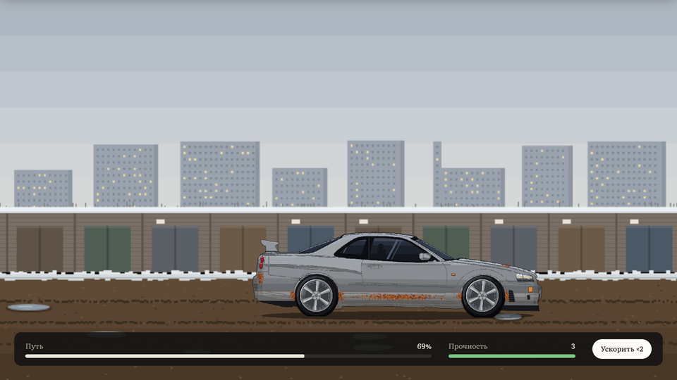

<p align="center">
  <picture>
    <source media="(prefers-color-scheme: dark)" srcset="docs/assets/logo-dark.svg">
    
  </picture>
</p>

<p align="center">
  <a href="https://makedonskiyy.github.io/grandpa-garage/"></a>
  <a href="https://github.com/Makedonskiyy/grandpa-garage/actions/workflows/ci.yml"></a>
  <a href="https://github.com/Makedonskiyy/grandpa-garage/actions/workflows/deploy.yml"></a>
  <a href="LICENSE"></a>
</p>

<p align="center">
  
  
  
  
  
</p>

<p align="center"><b>Браузерная 2D-игра в пиксельной графике</b></p>

<p align="center">
  
</p>

## О чём игра

События происходят 22 ноября 2004 года. Дед насовсем уехал на дачу в другой город и оставил внуку гараж и свою старую японку. В гараже он оставил записку: одиннадцать лет он гонялся с соседом Палычем и ни разу его не обогнал. Нужно собрать машину и сделать это за них обоих.

## Как играть

1. Нажмите «Начать игру» и посмотрите предысторию (пробел — следующая реплика).
2. В гараже соберите машину. Внизу — разделы: колёса, двигатель, трансмиссия, подвеска, кузов, покраска, обслуживание. Наведите на деталь — слева видно, что она меняет и как скажется на заезде, справа — характеристики машины.
3. Загляните в «Обслуживание»: замените масло (старое отнимает 6% мощности), после обкатки подлатайте кузов.
4. **Обкатка.** Грунтовка с колеёй и глубокой грязью. Нужны шины для грунта (шипы или грязевая M/T) и прочные детали. На колее притормозите, в глубокую грязь въезжайте с разгону и держите газ.
5. **Заезд с Палычем.** 400 м быстрее 13,0 с. Нужны слики или спортивная резина, мощный мотор и лёгкий кузов — между заездами машину придётся пересобрать.
6. Не вышло — игра скажет, в чём дело: в сборке или в езде. После трёх неудач подряд подскажет дед.

### Старт по светофору

Загорается красный, потом жёлтые, потом зелёный. Время идёт с зелёного — реакция в зачёт.

- **Ручная коробка:** на красном и жёлтых держите газом стрелку тахометра в зелёной зоне, на зелёный включите первую передачу (<kbd>E</kbd> или лепесток «+»).
- **Автомат** (выбирается в настройках): на зелёный нажмите газ.
- Тронулись раньше зелёного — **фальстарт**: в заезде это поражение, на обкатке машина просто ждёт.

### Приборы

- **Тахометр** (слева, крупный): зелёная дуга — где переключаться, в окошке — передача. Рамка окошка зелёная — пора переключаться, красная — отсечка.
- **Спидометр** (справа): скорость в км/ч.
- Колёса задымили — пробуксовка, чуть отпустите газ.

## Управление

| Действие                        | Клавиши                              | На экране       |
| ------------------------------- | ------------------------------------ | --------------- |
| Детали, разделы, кнопки         | мышь                                 | —               |
| Газ                             | <kbd>W</kbd> / <kbd>↑</kbd>          | правая педаль   |
| Тормоз                          | <kbd>S</kbd> / <kbd>↓</kbd>          | левая педаль    |
| Первая на старте, передача выше | <kbd>E</kbd> / <kbd>Shift</kbd>      | лепесток «+»    |
| Передача ниже                   | <kbd>Q</kbd> / <kbd>Ctrl</kbd>       | лепесток «−»    |
| Следующая реплика               | <kbd>Пробел</kbd> / <kbd>Enter</kbd> | клик            |
| Настройки, закрыть окно         | <kbd>Esc</kbd>                       | значок настроек |

Покраска и неон на результат не влияют.

## Скриншоты

<table>
  <tr>
    <td></td>
    <td></td>
  </tr>
  <tr>
    <td></td>
    <td></td>
  </tr>
</table>

## Запуск

Игру можно открыть по ссылке: **https://makedonskiyy.github.io/grandpa-garage/**

Для локального запуска нужны [Node.js](https://nodejs.org/) 20 или новее и [Git](https://git-scm.com/):

```bash
git clone https://github.com/Makedonskiyy/grandpa-garage.git
cd grandpa-garage
npm install
npm run dev
```

Откройте адрес из терминала (обычно http://localhost:5173).

<details>
<summary>Другие команды</summary>

| Команда               | Что делает                                                |
| --------------------- | --------------------------------------------------------- |
| `npm run build`       | Сборка в папку `dist`                                     |
| `npm run preview`     | Запуск собранной версии                                   |
| `npm test`            | Тесты                                                     |
| `npm run check`       | Линтер, форматирование, тесты и сборка разом              |
| `npm run car`         | Пересобрать пиксельную машину из генератора               |
| `npm run art`         | Пересобрать пиксельные фоны из исходных картинок          |
| `npm run garage-bg`   | Пересобрать фон гаража (нужен скилл codixel)              |
| `npm run start-light` | Пересобрать пиксельный светофор (скилл pixel-art, Python) |
| `npm run hud`         | Пересобрать педали и лепестки приборной панели (SVG)      |

</details>

## Лицензия

Код распространяется под лицензией [GNU GPL v3.0](LICENSE). Шрифты Literata, Caveat, Cormorant Garamond и Inter — под SIL Open Font License 1.1, иконки Phosphor — под лицензией MIT.
