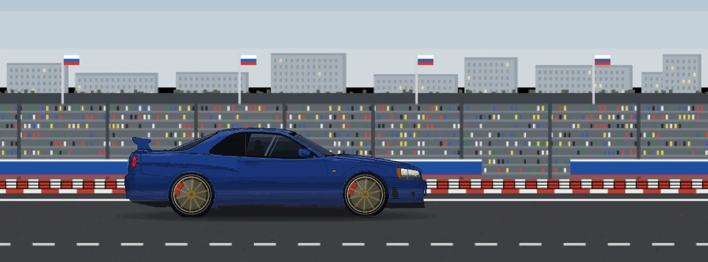

<p align="center">
  <picture>
    <source media="(prefers-color-scheme: dark)" srcset="docs/assets/logo-dark.svg">
    
  </picture>
</p>

**Дедов гараж** — браузерная игра про старую японскую машину, которую дед оставил внуку. На дворе ноябрь 2004-го. Дед годами гонялся с соседом Палычем. Теперь внуку предстоит собрать машину, пройти обкатку и попробовать обогнать Палыча в заезде на 400 метров.

[Играть в браузере](https://makedonskiyy.github.io/grandpa-garage/)



## Управление

**W / ↑** — газ, **S / ↓** — тормоз, **Пробел** — ручник. На ручной коробке **E** включает первую на зелёный и повышает передачу в движении, **Q** понижает. Автомат можно включить в настройках.

## Локальный запуск

Понадобятся Git и Node.js 22.12 или новее.

```bash
git clone https://github.com/Makedonskiyy/grandpa-garage.git
cd grandpa-garage
npm ci
npm run dev
```

Откройте адрес, который появится в терминале.

[Лицензия GPL-3.0](LICENSE)

## Тестовый мультиплеер

«Выбрать трассу» → «Мультиплеер» открывает лобби. В дуэли оба игрока получают одинаковую машину с ручной коробкой, поэтому настройки сюжетной сборки на результат не влияют. Заезд на 400 м проходит по ночному проспекту. Результаты дружеских заездов не меняют сюжет и не формируют рейтинг.

Для локальной проверки запустите в двух терминалах `npm run lobby` и `npm run dev`, затем откройте игру в двух профилях браузера. В лобби понадобятся разные ники.

Для GitHub Pages нужен один запущенный экземпляр `npm run lobby` за HTTPS-прокси. Сервис слушает `127.0.0.1:8787` по умолчанию, параметры окружения `HOST` и `PORT` задают интерфейс и порт. Установите `GAME_ORIGIN=https://makedonskiyy.github.io` на сервисе и задайте переменную репозитория `MULTIPLAYER_URL` с полным HTTPS-адресом эндпоинта `/lobby`. GitHub Actions передаст её сборке Pages. Для локальной production-сборки используется `VITE_MULTIPLAYER_URL`.

Лобби держит присутствие и текущие заезды в памяти. Перезапуск сбрасывает их. В тестовом режиме браузеры считают физику у себя, а сервер сравнивает присланные времена. Это режим для дружеских гонок без защиты рейтинга от модифицированного клиента.
